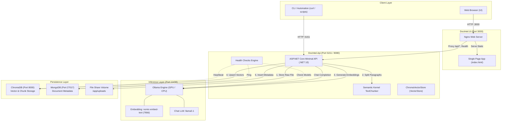
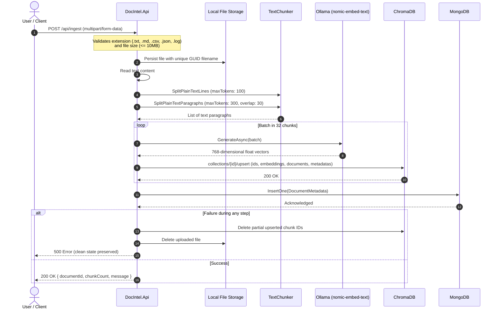
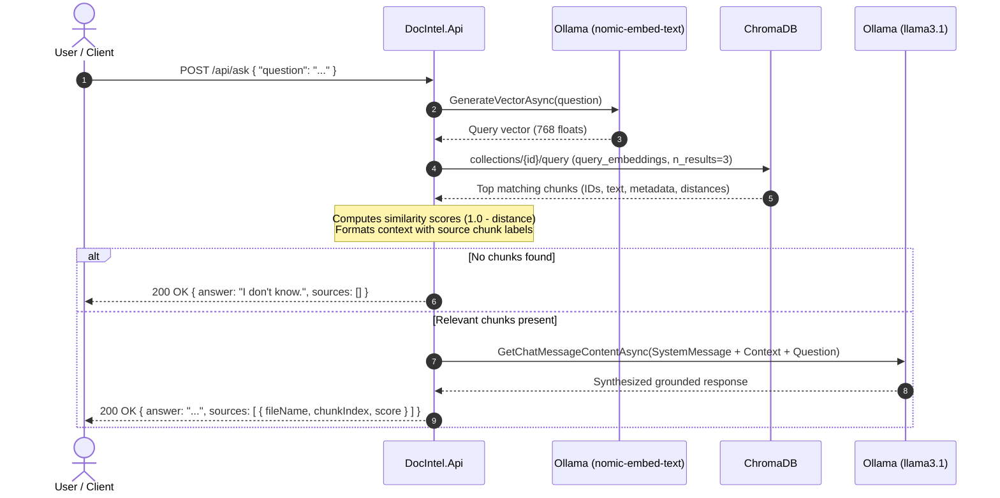

# DocIntel &mdash; Document Intelligence & Local RAG System

[](https://dotnet.microsoft.com/)
[](https://github.com/microsoft/semantic-kernel)
[](https://www.trychroma.com/)
[](https://www.mongodb.com/)
[](https://ollama.com/)
[](https://www.docker.com/)

**DocIntel** is an enterprise-grade, privacy-first Document Intelligence and Retrieval-Augmented Generation (RAG) platform. It enables local document ingestion, semantic chunking, high-dimensional vector embeddings, and contextual question-answering powered by self-hosted Large Language Models (LLMs) with zero external cloud dependencies.

---

## Table of Contents

- [The Overall Idea](#the-overall-idea)
- [Key Features](#key-features)
- [System Architecture](#system-architecture)
- [Technology Stack](#technology-stack)
- [Application Data Flow](#application-data-flow)
  - [1. Ingestion & Vectorization Pipeline](#1-ingestion--vectorization-pipeline)
  - [2. Query & Retrieval-Augmented Generation (RAG) Pipeline](#2-query--retrieval-augmented-generation-rag-pipeline)
  - [3. Health & Readiness Diagnostics](#3-health--readiness-diagnostics)
- [Component Breakdown](#component-breakdown)
  - [DocIntel.Api (Backend)](#docintelapi-backend)
  - [DocIntel.Ui (Frontend)](#docintelui-frontend)
  - [Data Stores (ChromaDB & MongoDB)](#data-stores-chromadb--mongodb)
  - [AI Inference Engine (Ollama)](#ai-inference-engine-ollama)
- [API Reference](#api-reference)
- [Getting Started](#getting-started)
  - [Prerequisites](#prerequisites)
  - [1. Pull Required Models](#1-pull-required-models)
  - [2. Run with Docker Compose](#2-run-with-docker-compose)
  - [3. Run Locally for Development](#3-run-locally-for-development)
- [Testing & Verification](#testing--verification)
- [Configuration Settings](#configuration-settings)
- [Security & Reliability](#security--reliability)

---

## The Overall Idea

Organizations frequently possess sensitive textual information&mdash;internal HR guidelines, policy documents, operational runbooks, engineering documentation, and logs&mdash;that employees need to query in natural language. Sending confidential internal documents to public cloud AI APIs poses compliance, privacy, and cost hurdles.

**DocIntel solves this by executing the entire intelligence loop entirely on-premises or within a private cloud:**

1. **Ingest & Protect**: Internal documents (`.txt`, `.md`, `.csv`, `.json`, `.log`) are parsed and chunked using boundary-aware semantic splitting.
2. **Embed Locally**: Chunks are transformed into 768-dimensional dense vectors using Ollama's local `nomic-embed-text` model.
3. **Dual Storage Architecture**:
   - **ChromaDB** stores high-dimensional embeddings and text chunks for sub-millisecond semantic search.
   - **MongoDB** maintains document-level metadata, tracking upload timestamps, chunk counts, and file references.
4. **Contextual Synthesized Answers**: When users ask questions, DocIntel retrieves the top most relevant chunks using cosine similarity, builds an anchored prompt, and prompts a local LLM (`llama3.1`) to answer strictly based on the retrieved context, complete with source citations.
5. **No Hallucinations Policy**: The system prompt instructs the model to declare `"I don't know"` if the context does not contain the answer.

---

## Key Features

- **100% On-Premises / Offline Capable**: Zero external API calls. Runs fully inside Docker with optional GPU acceleration.
- **Smart Semantic Chunking**: Employs Microsoft Semantic Kernel's `TextChunker` to split content along natural line boundaries and overlapping paragraphs (300 max tokens per paragraph, 30 token overlap).
- **Custom ChromaDB Vector Store Connector**: Implements `Microsoft.Extensions.VectorData.VectorStore` abstractions targeting ChromaDB v2 REST API.
- **Batch Embedding Generation**: Embeddings are calculated in batches of 32 for optimal throughput.
- **Full Traceability & Citations**: Answers include references to source file names, document IDs, chunk indices, and cosine similarity scores.
- **Self-Healing / Consistency Rollback**: If ingestion fails midway, partial ChromaDB chunks and uploaded disk files are cleanly rolled back.
- **Microservices Health Monitoring**: Real-time readiness checks probe MongoDB ping, Ollama model readiness, ChromaDB heartbeat, and vector collection status.
- **Modern Web UI**: Single-page studio interface featuring health status indicators, file drag-and-drop ingestion, interactive RAG query view with source cards, and an API inspection console.

---

## System Architecture



---

## Technology Stack

| Layer | Component | Description |
| :--- | :--- | :--- |
| **Backend Framework** | [.NET 10](https://dotnet.microsoft.com/) / ASP.NET Core | High-performance Minimal APIs, OpenAPI integration |
| **Semantic AI SDK** | [Microsoft Semantic Kernel](https://github.com/microsoft/semantic-kernel) 1.81.0 | Text chunking, OpenAI connectors configured for Ollama |
| **Vector Abstraction** | [Microsoft.Extensions.VectorData](https://learn.microsoft.com/en-us/dotnet/api/microsoft.extensions.vectordata) 10.10.0 | Unified abstractions for vector querying and upserts |
| **Vector Store** | [ChromaDB](https://www.trychroma.com/) (chromadb/chroma) | Dedicated persistent vector database for dense chunk embeddings |
| **Metadata Database** | [MongoDB](https://www.mongodb.com/) (mongo:latest) | Document registry, chunk metrics, and audit timestamps |
| **Local LLM Engine** | [Ollama](https://ollama.com/) | Local execution of `llama3.1` (generation) & `nomic-embed-text` (vectors) |
| **Frontend UI** | Modern Vanilla JS / HTML5 / CSS3 | Fast, dependency-free responsive dashboard |
| **Web Server / Proxy** | [Nginx](https://nginx.org/) (Alpine) | Static asset host and reverse proxy for backend endpoints |
| **Orchestration** | Docker & Docker Compose | Multi-container setup with shared volumes and GPU reservations |

---

## Application Data Flow

### 1. Ingestion & Vectorization Pipeline

When an authorized user uploads a document to `POST /api/ingest`, the system processes the file through the following sequence:



### 2. Query & Retrieval-Augmented Generation (RAG) Pipeline

When a user submits a natural-language question to `POST /api/ask`:



### 3. Health & Readiness Diagnostics

DocIntel implements Kubernetes-compliant health probes:

- **Liveness (`GET /health/live`)**: Confirms the web process is running. Always returns `200 OK` if the process is responsive.
- **Readiness (`GET /health`)**: Verifies every dependency before routing traffic:
  - **MongoDB**: Sends `{ ping: 1 }` command to admin DB.
  - **Ollama**: Queries `GET /v1/models` and ensures configured models (`llama3.1` and `nomic-embed-text`) are pulled.
  - **ChromaDB**: Calls `/api/v2/heartbeat`.
  - **Vector Store**: Verifies the vector collection exists and is ready for queries.

---

## Component Breakdown

### DocIntel.Api (Backend)
- **Framework**: .NET 10 Minimal API.
- **Entry Point**: [`Program.cs`](file:///c:/local/boom/src/doc-intel/DocIntel.Api/Program.cs).
- **Custom ChromaDB Connector**: [`ChromaVectorStore.cs`](file:///c:/local/boom/src/doc-intel/DocIntel.Api/ChromaVectorStore.cs) translates high-level vector store operations (`EnsureCollectionExistsAsync`, `UpsertAsync`, `SearchAsync`, `DeleteAsync`) into ChromaDB REST calls.
- **Data Models**:
  - [`DocumentMetadata.cs`](file:///c:/local/boom/src/doc-intel/DocIntel.Api/DocumentMetadata.cs): MongoDB entity tracking document ID, original filename, physical path, chunk count, and upload timestamp.
  - [`TextChunkRecord.cs`](file:///c:/local/boom/src/doc-intel/DocIntel.Api/TextChunkRecord.cs): Vector record storing chunk ID, document reference, text snippet, chunk index, and `ReadOnlyMemory<float>` (768 dimensions).
- **Health Checks**: [`HealthChecks.cs`](file:///c:/local/boom/src/doc-intel/DocIntel.Api/HealthChecks.cs) provides structured JSON reporting of dependency latencies and statuses.

### DocIntel.Ui (Frontend)
- **Static Assets**: Located in `DocIntel.Ui/` ([`index.html`](file:///c:/local/boom/src/doc-intel/DocIntel.Ui/index.html)).
- **Nginx Reverse Proxy**: [`nginx.conf`](file:///c:/local/boom/src/doc-intel/DocIntel.Ui/nginx.conf) listens on port 80 (mapped to port 3000), serving the UI and proxying `/api/`, `/health`, and `/openapi/` requests to `http://docintel-api:8080/`.
- **Views**:
  1. **System Health**: Dynamic cards showing ping, latency, and model availability for all infrastructure components.
  2. **Ingest Document**: Drag-and-drop file uploader with live chunk count feedback.
  3. **Ask & Search**: Chat interface with quick sample prompts, streaming indicator, grounded response display, and expandable source references with similarity percentages.
  4. **API Console**: In-browser test runner for direct endpoint execution.

### Data Stores (ChromaDB & MongoDB)
- **ChromaDB (`chromadb/chroma`)**: Stores vector embeddings and provides cosine similarity search. Data is persisted in named Docker volume `chroma_data`.
- **MongoDB (`mongo`)**: Document catalog and metadata store. Data is persisted in named Docker volume `mongo_data`.
- **Shared Volume (`DocIntel_FileShare`)**: Dedicated volume mounted at `/app/uploads` ensuring physical files persist across container restarts.

### AI Inference Engine (Ollama)
- **Container**: `ollama/ollama` listening on port 11434.
- **Hardware Acceleration**: Configured in `docker-compose.yml` with NVIDIA GPU reservations (`capabilities: [gpu]`). Falls back seamlessly to CPU if no compatible GPU is present.

---

## API Reference

### 1. Ingest Document
Uploads and processes a plain-text document.

- **URL**: `/api/ingest`
- **Method**: `POST`
- **Content-Type**: `multipart/form-data`
- **Form Field**: `file` (Binary file content)
- **Supported Formats**: `.txt`, `.md`, `.csv`, `.json`, `.log`
- **Maximum Size**: 10 MB (API default) / 25 MB (Nginx proxy)

**Success Response (200 OK):**
```json
{
  "documentId": "65f2a1b9c3e4d56789012345",
  "chunkCount": 6,
  "message": "Successfully vectorized 6 chunks."
}
```

### 2. Ask Question (RAG)
Queries the knowledge base and generates a grounded response.

- **URL**: `/api/ask`
- **Method**: `POST`
- **Content-Type**: `application/json`

**Request Body:**
```json
{
  "question": "How much is the home office allowance and how do I claim it?"
}
```

**Success Response (200 OK):**
```json
{
  "answer": "Employees can claim a one-time home office allowance of 500 USD for furniture such as a desk or chair. Claims must be submitted through the Expenses portal within 60 days of purchase.",
  "sources": [
    {
      "documentId": "65f2a1b9c3e4d56789012345",
      "fileName": "sample.txt",
      "chunkIndex": 2,
      "score": 0.8415
    }
  ]
}
```

### 3. List Ingested Documents
Retrieves metadata of all processed documents.

- **URL**: `/api/documents`
- **Method**: `GET`

**Success Response (200 OK):**
```json
[
  {
    "id": "65f2a1b9c3e4d56789012345",
    "fileName": "remote-work-policy.txt",
    "filePath": "/app/uploads/9b4f2c81...txt",
    "chunkCount": 6,
    "uploadedAt": "2026-10-11T16:20:00Z"
  }
]
```

### 4. Health Readiness Probe
Performs active connection and readiness checks on all dependencies.

- **URL**: `/health`
- **Method**: `GET`

**Success Response (200 OK):**
```json
{
  "status": "Healthy",
  "totalDurationMs": 14.2,
  "checks": {
    "mongodb": { "status": "Healthy", "description": "MongoDB is reachable.", "durationMs": 2.1 },
    "ollama": { "status": "Healthy", "description": "Ollama is reachable and all models are available.", "durationMs": 6.8 },
    "chromadb": { "status": "Healthy", "description": "ChromaDB is reachable.", "durationMs": 3.4 },
    "vector-store": { "status": "Healthy", "description": "Vector collection is available in ChromaDB.", "durationMs": 1.9 }
  }
}
```

### 5. Health Liveness Probe
Lightweight endpoint confirming API process vitality.

- **URL**: `/health/live`
- **Method**: `GET`
- **Response**: `200 OK` `{"status": "Healthy"}`

---

## Getting Started

### Prerequisites
- [Docker](https://www.docker.com/) & Docker Compose
- (Optional for local development) [.NET 10 SDK](https://dotnet.microsoft.com/download/dotnet/10.0)
- (Optional for GPU) NVIDIA GPU Drivers & [NVIDIA Container Toolkit](https://docs.nvidia.com/datacenter/cloud-native/container-toolkit/latest/install-guide.html)

### 1. Pull Required Models
Before or immediately after starting the containers, ensure Ollama has the models pulled:

```bash
# If Ollama is running locally on your host:
ollama pull llama3.1
ollama pull nomic-embed-text

# Or if running inside the Docker container:
docker exec -it doc-intel-ollama-1 ollama pull llama3.1
docker exec -it doc-intel-ollama-1 ollama pull nomic-embed-text
```

### 2. Run with Docker Compose
Start the complete stack with a single command:

```bash
docker compose up --build -d
```

Once started, the services will be available at:
- **Web UI**: [http://localhost:3000](http://localhost:3000)
- **Backend API**: [http://localhost:5151](http://localhost:5151)
- **OpenAPI Document**: [http://localhost:5151/openapi/v1.json](http://localhost:5151/openapi/v1.json)
- **ChromaDB**: [http://localhost:8000](http://localhost:8000)
- **Ollama**: [http://localhost:11434](http://localhost:11434)
- **MongoDB**: `localhost:27017`

To check logs:
```bash
docker compose logs -f docintel-api
```

To stop the stack:
```bash
docker compose down
```

### 3. Run Locally for Development

If you prefer running the backend in Visual Studio or via `dotnet run` while running infrastructure containers in Docker:

1. Start only the backing infrastructure:
   ```bash
   docker compose up mongodb chromadb ollama -d
   ```

2. Run the .NET API:
   ```bash
   cd DocIntel.Api
   dotnet run --launch-profile http
   ```
   The API will listen on `http://localhost:5151`.

---

## Testing & Verification

Several helper scripts and HTTP files are included for rapid testing:

### PowerShell Test Suite
Run the automated end-to-end integration script:
```powershell
cd DocIntel.Api
.\test-api.ps1
```
This script tests:
1. Liveness and readiness endpoints.
2. File ingestion of [`sample.txt`](file:///c:/local/boom/src/doc-intel/DocIntel.Api/sample.txt).
3. Validation errors (invalid extension, empty file).
4. Question answering with grounded answers and citations.
5. Out-of-domain questions verifying `"I don't know"` fallback.

### Curl Quick-Start
From PowerShell or Bash:
```powershell
# Health check
curl.exe http://localhost:5151/health

# Ingest sample policy
curl.exe -X POST http://localhost:5151/api/ingest -F "file=@sample.txt;type=text/plain"

# List documents
curl.exe http://localhost:5151/api/documents

# Ask a question
'{"question":"What are the core hours for remote employees?"}' | curl.exe -X POST http://localhost:5151/api/ask -H "Content-Type: application/json" --data-binary "@-"
```

### Visual Studio / VS Code HTTP Client
Open [`DocIntel.Api/DocIntel.Api.http`](file:///c:/local/boom/src/doc-intel/DocIntel.Api/DocIntel.Api.http) to execute requests directly inside your IDE.

---

## Configuration Settings

Settings can be customized via [`appsettings.json`](file:///c:/local/boom/src/doc-intel/DocIntel.Api/appsettings.json) or overridden with environment variables:

| Setting | Environment Variable | Default Value | Description |
| :--- | :--- | :--- | :--- |
| `ConnectionStrings:MongoDb` | `ConnectionStrings__MongoDb` | `mongodb://localhost:27017` | MongoDB connection string |
| `MongoDb:DatabaseName` | `MongoDb__DatabaseName` | `DocIntel` | Database name for document metadata |
| `Ollama:Endpoint` | `Ollama__Endpoint` | `http://localhost:11434/v1` | Ollama OpenAI-compatible endpoint |
| `Ollama:ChatModel` | `Ollama__ChatModel` | `llama3.1` | Model name for chat completion |
| `Ollama:EmbeddingModel` | `Ollama__EmbeddingModel` | `nomic-embed-text` | Model name for vector embeddings |
| `Chroma:Endpoint` | `Chroma__Endpoint` | `http://localhost:8000` | ChromaDB REST endpoint |
| `Ingestion:UploadFolder` | `Ingestion__UploadFolder` | `uploads` | Directory on disk to store raw files |
| `Ingestion:MaxFileSizeBytes`| `Ingestion__MaxFileSizeBytes`| `10485760` (10 MB) | Maximum permitted file upload size |

---

## Security & Reliability

- **Path Traversal Protection**: Client-provided filenames are never written directly to the file system. Each file is stored with a cryptographically secure GUID (`{Guid.NewGuid():N}{extension}`) while the original human-readable filename is safely retained in database metadata.
- **Format Whitelisting**: Strict extension verification prevents executable or unsupported binary uploads.
- **Rollback Guarantee**: Ingestion operates under an all-or-nothing guarantee. In the event of embedding generation timeout or DB write failure, newly created vector records and uploaded disk files are cleaned up immediately.
- **Non-Root Execution**: Backend container runs under the unprivileged non-root `$APP_UID` user with pre-provisioned file share permissions.
- **Container Isolation**: Front-facing web traffic enters through the hardened Nginx reverse proxy.
